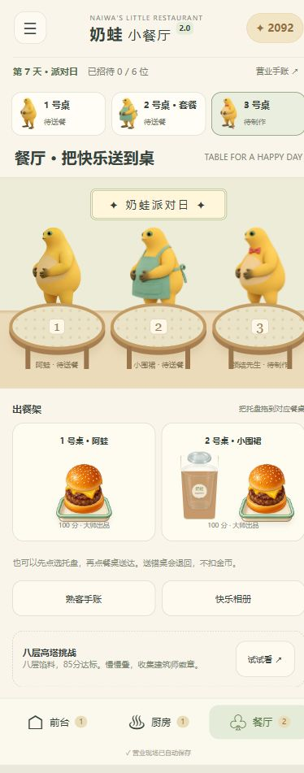

# 奶蛙餐厅 2.0

手机竖屏优先的休闲餐饮经营小游戏。前台接单、厨房制作、餐厅送餐，用认真摆好的汉堡和奶茶换来奶蛙的经典大笑。

纯静态网页，无账号、数据库或外部 CDN；没有耐心倒计时，也不会烧焦。

<p align="center"></p>

> 截图为第 7 天测试存档；新玩家从第 1 天开始，内容随营业日逐步解锁。

## 快速开始

准备 Node.js 20 或更新版本，然后运行：

```sh
git clone https://github.com/JJHenry114/naiwa-kitchen.git
cd naiwa-kitchen
npm start
```

打开 [本地游戏](http://127.0.0.1:8767/)。没有第三方运行依赖，无需先执行 `npm install`。

Windows 也可以双击根目录的 **启动奶蛙餐厅.cmd**，启动器默认打开 [8770 端口](http://127.0.0.1:8770/)，并复用该端口上已经启动的本游戏服务。如果脚本被系统策略限制，请使用上面的终端启动方式。

两个启动方式的端口不同，浏览器进度各自独立。建议固定一种方式游玩，或通过设置中的备份导入功能转移进度。不要直接双击 HTML；游戏使用 ES modules，需要通过 HTTP 访问。

本地服务仅供这台电脑访问。GitHub 仓库地址是源码页面；分享手机试玩需要另外部署 `dist/`。

## 玩法与成长

| 内容 | 说明 |
| --- | --- |
| 三场景经营 | 前台录单与分桌，厨房独立制作，餐厅拖动托盘送达；三张餐桌、最多三张普通订单 |
| 手工汉堡 | 双面煎制、滑动翻面、拖动摆放、调整最上层、撤回和重做；最多 14 层 |
| 手工奶茶 | 滑动倾倒、按份加料、沿环搅拌、对齐杯盖；支持键盘辅助操作 |
| 质量与小费 | 根据摆盘、对齐、份量和搅拌评分；实际成品用于托盘、评价和相册 |
| 长期经营 | 营业日、六种熟客、设备升级、装修、衣橱和快乐相册 |
| 特殊内容 | 第 4 天高塔挑战，第 5 天起评论员，第 6 天起套餐，第 7 天起主题日 |
| 流畅与恢复 | 原声与 WebGL 角色表现、轻柔动画、后台暂停、自动存档与手动备份 |

## 文档导航

- [完整玩法、评分、存档兼容和工程结构](UPGRADE-2.0.md)
- [版本更新记录](CHANGELOG.md)
- [测试结果与真机验证范围](TEST-RESULTS-2.0.md)
- [后续修改与 Git / GitHub 工作流程](GIT-UPDATE.md)

## 开发与测试

```sh
npm test
npm run qa:saves
```

当前有 63 项自动测试。第二条命令生成本地测试存档，位于 `.sites-runtime/qa/`，可在独立测试网址通过游戏设置导入。导入会替换该网址的游戏进度，导入前会自动保留一份可撤回的备份。

`dist/` 是可直接部署的游戏文件，无需构建。主要模块为 `restaurant.js`（经营状态）、`quality.js`（评分）、`views.js`（场景）、`restaurant-app.js`（交互）和 `album.js`（合照）。

素材已经包含在 `dist/assets/`。`scripts/prepare-assets.py` 和 `export-laugh.ps1` 仅用于重新制作素材，依赖原始素材或视频，不是运行游戏的必要步骤。

## 静态部署与存档

将 `dist/` 的内容作为站点根目录部署，保留文件之间的相对路径。主入口 `/index.html` 与 `/v2.html` 均为 2.0，旧版保留在 `/legacy.html`。

浏览器存档与网址绑定；变更域名、端口或浏览器前，请在设置中保存进度备份。2.0 自动迁移同源旧版的金币、衣橱、收藏、设置与历史成绩，完整规则见更新说明。

上传源码到 GitHub 不等于发布试玩网站。本仓库不包含自动部署配置。
